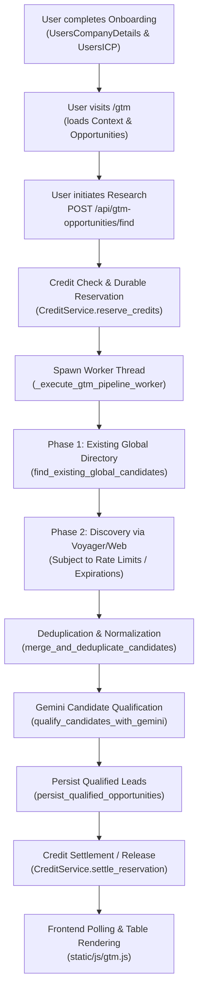
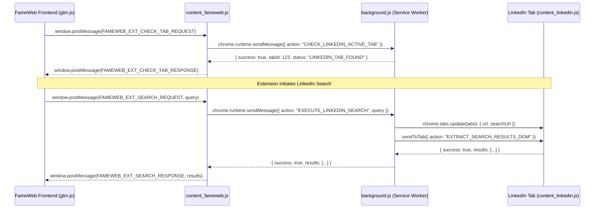
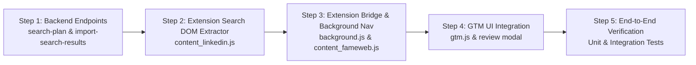

# FameWeb GTM – LinkedIn Lead Discovery Architecture Audit

**Target Deliverable:** `docs/research/GTM_LinkedIn_Search_Architecture_Audit.md`  
**Investigation Mode:** Strict Read-Only Audit  
**Date:** November 2026  
**Status:** Complete  

---

## Executive Summary

FameWeb's Go-To-Market (GTM) module currently combines **company offering data**, **Ideal Customer Profile (ICP)** criteria, **Gemini AI** (for search query generation and evidence-based lead qualification), and a robust **PostgreSQL data layer** (`global_profiles`, `users_profiles`, `research_jobs`, credit wallets/reservations).

Historically, the background execution worker (`_execute_gtm_pipeline_worker` in `app/services/gtm_pipeline_service.py`) attempted automated discovery through two channels:
1. Server-side private LinkedIn Voyager API calls (`discover_candidates_via_voyager`), which rely on stored encrypted credentials.
2. Web/Claude searches (`discover_candidates_via_public_web`, `discover_candidates_with_claude`).

To satisfy **strict user requirements**—zero third-party paid enrichers (Apollo, Proxycurl, PDL, Crustdata), zero private Voyager session replay, zero storage or transmission of raw `li_at` cookies, and free user-controlled LinkedIn search—this audit details how the existing **Chrome Extension bridge** (`linkedin_extension/`) can be extended from single-profile extraction to **interactive LinkedIn search result discovery**.

By keeping the user in the loop (FameWeb generates queries via Gemini $\rightarrow$ Chrome extension navigates the active, authenticated LinkedIn tab to the standard search results $\rightarrow$ user selects relevant prospects $\rightarrow$ extension passes visible DOM cards back $\rightarrow$ Gemini scores and qualifies $\rightarrow$ existing database persists), FameWeb achieves **100% compliant, free, reliable, and user-consented lead discovery**.

---

## 1. Existing GTM Architecture & Pipeline Analysis

### 1.1 Complete Flow: From ICP Input to Saved Opportunities



1. **Context Resolution (`get_user_gtm_context`)**:
   - Queries `UsersCompanyDetails`, `UsersICP`, and `UsersLinkedinDetails` by `user_id`.
   - Assembles `offer` text (`what_company_sells` $\rightarrow$ `products_services` $\rightarrow$ `description`).
   - Assembles `target_icp` string (`target_customer`, `target_jobs_roles`, `industry`, `company_size`, `location`, `keywords`).
   - Checks for active background research jobs (`ResearchJobs` with status `QUEUED` or `RUNNING`).

2. **Job Initiation (`start_gtm_research_job` via `POST /api/gtm-opportunities/find`)**:
   - Validates that `target_leads` is an integer between 5 and 50.
   - Enforces single-job concurrency (`ResearchJobs` index `idx_active_research_job`).
   - Calculates credit cost using `FeaturePricing` (`feature_code="GTM_RESEARCH_LEAD"`).
   - Verifies credit balance and creates a `CreditReservation` atomically.
   - Spawns background worker thread `_execute_gtm_pipeline_worker`.

3. **Background Worker Execution (`_execute_gtm_pipeline_worker`)**:
   - **Step 1 (Directory-First Search)**: Searches existing `GlobalProfiles` (`find_existing_global_candidates`) not yet connected to this user. Qualifies them via Gemini; if enough match $\ge 70$, saves them directly.
   - **Step 2 (External Discovery)**: If deficit remains, runs discovery.
   - **Step 3 (Normalization & Deduplication)**: Merges raw results using `normalize_linkedin_identifier` (vanity slug or URN).
   - **Step 4 (Gemini Qualification)**: Evaluates candidates against ICP criteria (`qualify_candidates_with_gemini`).
   - **Step 5 (Persistence & Settlement)**: Saves to `GlobalProfiles` and `UsersProfiles`, then settles the `CreditReservation` strictly for newly delivered qualified leads ($fit\_score \ge 70$).

4. **Frontend Dashboard Polling (`static/js/gtm.js`)**:
   - Polls `/api/gtm/jobs/<id>/status` every 2000ms until `COMPLETED` or `FAILED`.
   - On completion, calls `loadOpportunities()` (`GET /api/gtm-opportunities`) to populate the table.

### 1.2 Reusable Components (Zero Code Modification Required)

| Component | File | Reusability Evaluation |
|---|---|---|
| `get_user_gtm_context` | `app/services/gtm_pipeline_service.py` | **100% reusable**. Extracts all ICP and company details. |
| `_call_gemini_with_fallback` | `app/services/gtm_pipeline_service.py` | **100% reusable**. Manages model fallbacks, temperature, and usage logging. |
| `qualify_candidates_with_gemini` | `app/services/gtm_pipeline_service.py` | **100% reusable**. Scores prospects from 0-100, assigns tiers, and extracts intent signals. |
| `persist_qualified_opportunities` | `app/services/gtm_pipeline_service.py` | **100% reusable**. Deduplicates `GlobalProfiles` and maintains tenant-isolated `UsersProfiles`. |
| `CreditService` | `app/services/credit_service.py` | **100% reusable**. Handles wallet balances, reservations, settlements, and releases. |
| `normalize_linkedin_identifier` | `app/services/gtm_pipeline_service.py` | **100% reusable**. Extracts canonical vanity slugs from profile URLs. |
| `lead_validator.py` | `app/services/lead_validator.py` | **100% reusable**. Enforces SSRF safety and guards against hallucinated emails/phones. |
| `GET /api/gtm-opportunities` | `app.py` | **100% reusable**. Retrieves user-specific qualified opportunities. |
| `GET /api/gtm-opportunities/export` | `app.py` | **100% reusable**. Exports qualified prospects to CSV. |

---

## 2. ICP & Company Data Mapping

The database schema in `app/models/all_models.py` defines the canonical fields used across GTM.

### 2.1 Model: `UsersCompanyDetails` (`users_company_details`)

| Field Name | Type | Description | Mapping to Gemini Context |
|---|---|---|---|
| `company_name` | `String` | Legal / Brand Name | Passed as `company_name` |
| `website_url` | `String` | Company URL | Passed as `website_url` |
| `what_company_sells` | `String` | Core product offering | Priority 1 for `offer` text |
| `products_services` | `String` | Products & Services detail | Priority 2 for `offer` text |
| `description` | `String` | General company summary | Priority 3 for `offer` text |
| `industry` | `String` | Operating Industry | Passed as `industry` fallback |
| `company_size` | `String` | Employee count range | Used in qualification comparison |
| `revenue` | `String` | Annual revenue bracket | Used in qualification comparison |
| `location` | `String` | Headquarters Location | Used in geographic search filters |
| `other_details` | `String` | Value prop / notes | Optional additional context |

### 2.2 Model: `UsersICP` (`users_icp`)

| Field Name | Type | Description | Mapping to Gemini Context |
|---|---|---|---|
| `target_customer` | `String` | Target company type (e.g., "Mid-market B2B SaaS") | `icp_raw.target_customer` |
| `target_jobs_roles` | `String` | Target titles (e.g., "VP of Sales, CRO") | `icp_raw.target_jobs_roles` (Primary query driver) |
| `company_size` | `String` | Target headcounts (e.g., "50-200") | `icp_raw.company_size` |
| `revenue_range` | `String` | Target revenue (e.g., "$5M - $20M") | `icp_raw.revenue_range` |
| `industry` | `String` | Target industry vertical | `icp_raw.industry` |
| `location` | `String` | Target geographic focus | `icp_raw.location` |
| `keywords` | `String` | Domain keywords (e.g., "HubSpot, Salesforce") | `icp_raw.keywords` |
| `exclusions` | `String` | Negative criteria (e.g., "consultant, agency") | `icp_raw.exclusions` (Deterministic filter) |
| `signals` | `JSONB` | Buying signals & triggers | `icp_raw.signals` |
| `version` | `Integer` | Schema revision tracker | Attached to `UsersProfiles.icp_version` |

### 2.3 Exact Mapping Implementation
In `get_user_gtm_context(user_id)`:
```python
offer_text = company.what_company_sells or company.products_services or company.description or ""
target_icp_text = " | ".join([
    f"Target Customer: {icp.target_customer}",
    f"Roles: {icp.target_jobs_roles}",
    f"Industry: {icp.industry}",
    f"Size: {icp.company_size}",
    f"Location: {icp.location}",
    f"Keywords: {icp.keywords}"
])
```

---

## 3. Gemini Capabilities & Integration

### 3.1 Existing Gemini Configuration System
FameWeb already possesses a centralized, hardened Gemini configuration infrastructure in `app/services/gemini_service.py` and `app/services/gtm_pipeline_service.py`:
- **Active Key Discovery**: `get_active_gemini_api_key()` reads encrypted AES-256-GCM credentials from `system_settings` (key `GEMINI_API_CONFIG`) with fallback to `GEMINI_API_KEY` in environment.
- **Model Fallback Chain**:
  ```python
  GEMINI_MODELS_FALLBACK = [
      "gemini-3.5-flash-lite",
      "gemini-3.8-flash",
      "gemini-2.5-flash"
  ]
  ```
- **Execution Telemetry**: `_call_gemini_with_fallback()` automatically logs duration, tokens, operation tags (`SEARCH_PLANNING`, `CANDIDATE_QUALIFICATION`), and cost estimates to `AIProviderUsageLog`.

### 3.2 Task A: Search Query Planner (`generate_search_plan`)
The existing function `generate_search_plan(user_context, persona_filter)` already translates Company & ICP details into targeted search queries:
```json
{
  "search_keywords": "B2B SaaS Sales",
  "keyword_title": "VP Sales, CRO, Head of Growth",
  "target_industries": ["Software Development", "Information Technology"],
  "target_company_types": ["B2B SaaS", "Enterprise Software"],
  "queries": [
    {
      "id": "q1",
      "title": "VP of Sales",
      "keywords": "B2B SaaS",
      "industry": "Software Development",
      "location": "United States",
      "exclusions": ["intern", "student", "consultant"]
    }
  ]
}
```
*Enhancement for LinkedIn Search URLs:*  
A simple helper can convert these query objects into standard LinkedIn search URLs:
```
https://www.linkedin.com/search/results/people/?keywords=VP%20Sales%20B2B%20SaaS&origin=GLOBAL_SEARCH_HEADER
```

### 3.3 Task B: Evidence-Based Qualification (`qualify_candidates_with_gemini`)
1. **Deterministic Exclusion**: Drops candidates matching negative criteria (e.g., "intern", "student", "freelance") before invoking the model, saving API tokens.
2. **Scoring & Explanation**: Evaluates candidates against `offer` and `target_icp`, outputting:
   - `fit_score`: Integer 0–100.
   - `tier`: `Tier 1 Priority Match` (85-100), `Tier 2 Match` (70-84), or `Moderate Match` (<70).
   - `qualification_reason`: Concrete reason based on title and industry alignment.
   - `intent_signals`: Concrete business triggers.
   - `recommended_angle`: Tailored outreach hook.

---

## 4. Existing Chrome Extension Bridge & Capabilities

The extension is located in `linkedin_extension/` (Manifest V3, v1.0.2).

### 4.1 Architecture & Permissions
- **`manifest.json`**:
  - Permissions: `cookies`, `tabs`, `activeTab`, `storage`, `scripting`.
  - Host permissions: `https://*.linkedin.com/*`, `http://localhost:5000/*`, etc.
  - Content scripts:
    - `content_fameweb.js`: Injected into FameWeb at `document_start`.
    - `content_linkedin.js`: Injected into LinkedIn tabs at `document_idle`.
- **Zero-Credential Security Boundary**:
  - `checkLinkedInSession()` checks only the presence of the `li_at` cookie (`boolean` check). It **never** reads, serializes, or transmits cookie values.

### 4.2 Extension Messaging Pipeline



### 4.3 Navigating & Reading Search Results
`findBestLinkedInTab()` in `background.js` locates an active, non-login LinkedIn tab. When instructed to search:
1. `chrome.tabs.update(tabId, { url: searchUrl })` navigates the existing tab.
2. `chrome.tabs.onUpdated` waits for the page load to complete.
3. `content_linkedin.js` reads standard visible people-search DOM elements:
   - Results container: `ul.reusable-search__entity-result-list`, `div.search-results-container`.
   - Result item: `li.reusable-search__result-container`.
   - Name & Profile URL: `span.entity-result__title-text a.app-aware-link`.
   - Subtitle / Current Role: `div.entity-result__primary-subtitle`.
   - Secondary subtitle / Location: `div.entity-result__secondary-subtitle`.
   - Summary / Insights snippet: `p.entity-result__summary`.

---

## 5. Proposed LinkedIn Lead Discovery Workflow

### Stage 1 – Context Retrieval
The user opens `/gtm`. FameWeb loads company offering and ICP criteria from `GET /api/gtm-context`.

### Stage 2 – Gemini Search Query Generation
The frontend or backend calls `generate_search_plan(user_context)`. Gemini generates 5–10 diverse search queries (e.g., targeting specific seniority levels, roles, or keyword combinations).

### Stage 3 – User-Directed LinkedIn Execution
Instead of an opaque server scraper, the user triggers the search from the GTM interface:
1. The extension checks for an open LinkedIn tab (`CHECK_LINKEDIN_ACTIVE_TAB`).
2. The extension presents the search query or navigates the LinkedIn tab to:
   ```
   https://www.linkedin.com/search/results/people/?keywords=<ENCODED_QUERY>&origin=GLOBAL_SEARCH_HEADER
   ```
3. The content script waits for rendering and parses visible cards into a candidate list:
   - `name`
   - `role` / `headline`
   - `company`
   - `location`
   - `profile_url` (vanity URL)

### Stage 4 – User Review & Prospect Selection
The extension or FameWeb UI displays the discovered results in an interactive review modal:
- Shows prospect name, current role, company, and location.
- The user checks/selects which prospects they want to qualify.
- Avoids indiscriminate scraping; gives the user full control of what enters their database.

### Stage 5 – Gemini Qualification
Selected prospects are posted to FameWeb (`POST /api/gtm/qualify-and-save`). FameWeb invokes `qualify_candidates_with_gemini`:
- Checks negative exclusions.
- Evaluates fit score (0–100), tier, intent signals, and recommended outreach angles.

### Stage 6 – Persistence & Credit Settlement
FameWeb persists the qualified prospects using `persist_qualified_opportunities`:
- Upserts deduplicated `GlobalProfiles` (keyed by vanity slug `linkedin_id`).
- Creates user-scoped `UsersProfiles` records.
- Settles credits via `CreditService.settle_reservation` for leads scoring $\ge 70$.

---

## 6. Exact Files & Functions for Implementation

| File | Proposed Change | Purpose |
|---|---|---|
| `app/services/gtm_pipeline_service.py` | Add `qualify_and_persist_discovered_leads(user_id, leads, job_id=None)` | Reuses `qualify_candidates_with_gemini` and `persist_qualified_opportunities` for extension-supplied leads. |
| `app.py` | Add route `POST /api/gtm/search-plan` | Returns Gemini-generated search queries directly to the frontend/extension. |
| `app.py` | Add route `POST /api/gtm/import-search-results` | Accepts selected prospects from the extension/frontend, qualifies, persists, and settles credits. |
| `linkedin_extension/content_linkedin.js` | Add `extractSearchResultsDom()` and handler for `EXTRACT_SEARCH_RESULTS_DOM` | Parses search result cards (`li.reusable-search__result-container`) from the active LinkedIn search tab. |
| `linkedin_extension/background.js` | Add `EXECUTE_LINKEDIN_SEARCH` action | Navigates the LinkedIn tab to the search URL and invokes DOM extraction. |
| `linkedin_extension/content_fameweb.js` | Add bridge message types for `SEARCH_REQUEST` and `SEARCH_RESPONSE` | Forwards search events between FameWeb DOM and `background.js`. |
| `static/js/gtm.js` | Add Extension Search trigger button and result review modal | Allows the user to run the search via extension, view candidates, and confirm import. |
| `templates/gtm.html` | Add "Search via LinkedIn Extension" action button and selection modal | UI controls for the search-and-review flow. |

---

## 7. Technical Limitations & Safeguards

1. **LinkedIn DOM Volatility**:
   - LinkedIn search result markup changes periodically. Multiple fallback selectors (`.reusable-search__result-container`, `div[data-view-name="search-entity-result-universal-template"]`) must be implemented, following the pattern proven in `content_linkedin.js`.
2. **Page Pagination & Bounding**:
   - Each LinkedIn search page returns 10 results. The extension should extract page-by-page (e.g. 10–20 results at a time) rather than aggressively auto-paginating across dozens of pages.
3. **Session State**:
   - The user must be logged into LinkedIn in Chrome. If logged out, the extension detects this via `checkDomAuthState()` and prompts the user to log in.
4. **Credit Integrity**:
   - Credits must only be deducted for qualified candidates ($fit\_score \ge 70$) successfully saved to `UsersProfiles`, matching the existing reservation and settlement contract.

---

## 8. Minimal Implementation Sequence



1. **Step 1: Backend Endpoints**:
   - Expose `POST /api/gtm/search-plan` to return queries from `generate_search_plan`.
   - Expose `POST /api/gtm/import-search-results` to qualify and persist incoming candidate arrays.
2. **Step 2: Extension DOM Extractor (`content_linkedin.js`)**:
   - Implement `extractSearchResultsDom()` to extract `{ name, role, company, location, profile_url }` from `https://www.linkedin.com/search/results/people/*`.
3. **Step 3: Background Worker & Bridge (`background.js`, `content_fameweb.js`)**:
   - Implement `EXECUTE_LINKEDIN_SEARCH` to navigate the tab to the encoded search URL and trigger `EXTRACT_SEARCH_RESULTS_DOM`.
4. **Step 4: GTM UI Integration (`gtm.html`, `gtm.js`)**:
   - Add a "Discover via LinkedIn Tab" button.
   - Display a review drawer or modal for the user to select prospects to qualify and import.
5. **Step 5: Testing & Verification**:
   - Add unit tests for payload validation, credit settlement, and deduplication.

---

## 9. Untouched Components (Strict Integrity)

To prevent regression in working systems, the following components **must remain untouched**:
- `app/routes/auth.py`, `app/security/` (Login, OTP, session management).
- `app/services/smtp_client.py`, `app/services/smtp_validator.py`, `app/services/bulk_email_sender.py` (Email/SMTP).
- `linkedin_extension/` top-card and detail profile extraction (`EXTRACT_OWN_PROFILE_DOM`, `EXTRACT_DETAIL_LIST_DOM` for Profile Optimization).
- `app/models/all_models.py` database schema and migrations.
- `app/services/credit_service.py` credit wallet and transaction formulas.

---

## 10. Recommendation for the Smallest, Most Reliable Implementation

The fastest and most robust path is to build a **Hybrid Search Workflow**:
1. **FameWeb generates queries** using existing `generate_search_plan()`.
2. **Chrome extension executes search navigation** in the user's active LinkedIn tab and returns parsed result cards to FameWeb.
3. **User selects desired leads** in FameWeb via a clean checklist preview.
4. **FameWeb backend qualifies and saves** selected leads using existing `qualify_candidates_with_gemini()` and `persist_qualified_opportunities()`.

This minimizes extension complexity, keeps AI qualification on the backend, guarantees zero cookie leakage, and provides complete user transparency.

